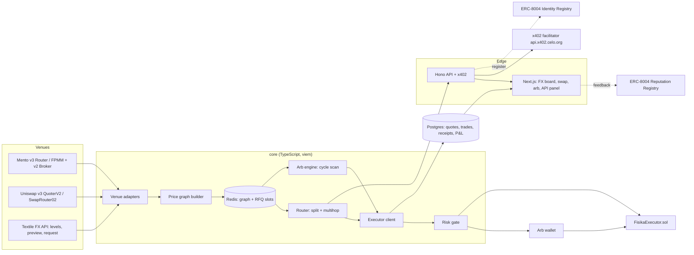

# fisika — Deliverable 2: Architecture

Status: draft v1, 26 Oct 2026. It builds on [01-research-report.md](01-research-report.md).

## 0. Decisions taken from your answers

| Question | Answer | Effect on the design |
|---|---|---|
| Textile access | None yet | Textile ships as a **non-atomic, EOA-taker** adapter that uses a self-serve live key, plus the public `/rfq/levels` feed. The atomic path stays behind a feature flag until the `rfq:aggregator` key exists. |
| Code location | `github.com/kryptnitan/fisika` | Monorepo described in §9. |
| Human interface | Web, not a bot | The Telegram bot (old deliverable 7) becomes a **web swap app** inside the Next.js frontend: connect a wallet, ask for a corridor, get a quote, sign it yourself. Alerts move to in-app and webhook notifications. |
| x402 asset | Any chain the facilitator supports | Accept **USDC and USDT on Celo** through the Celo facilitator. Base USDC can be added later through the CDP facilitator if we want listing in Coinbase's discovery catalog. |
| RPC | Not answered | Assumption: no paid RPC yet. Two public endpoints with failover, a **3-second graph refresh** instead of every block, and a hard requirement for a paid endpoint before LIVE mode. |
| Legal entity | Not answered | The client-facing API and web app stay **quote-only on mainnet** until this is settled. Paper and fork modes are unaffected. |

## 1. System overview



Five long-running processes share one Postgres and one Redis:

1. **graph** — polls the venues and writes the price graph.
2. **arb** — scans for cycles. It is the only process that signs with the arb wallet.
3. **api** — quotes, builds transactions, and handles x402.
4. **web** — the Next.js frontend.
5. **indexer** — reconciles receipts from chain events.

## 2. Venue adapters

```ts
interface VenueAdapter {
  id: 'mento' | 'uniswap-v3' | 'textile';
  pairs(): Promise<Pair[]>;                       // discovered, address-keyed
  quote(tokenIn: Address, tokenOut: Address, amountIn: bigint): Promise<Quote>;
  firmQuote?(req: QuoteReq & { taker: Address }): Promise<FirmQuote>;   // Textile only
  buildCall(leg: Leg, recipient: Address): Promise<Call>;               // for the executor / client tx
}

type Quote = {
  amountOut: bigint;       // net of venue fee
  gasEstimate: bigint;     // gas units
  expiry: number;          // unix ms
  firm: boolean;           // true = executable as-is at this block
  feeBps: number;
  source: string;          // pool address / exchangeId / 'textile-levels'
};
```

| Adapter | Quote source | `firm` | Execution path |
|---|---|---|---|
| **Mento** | Router `getAmountsOut` (or the SDK `quotes` service), after a tradability check (breakers, market hours, trading limits) | true while the next block is pending | `Router.swapExactTokensForTokens` |
| **Uniswap v3** | `QuoterV2.quoteExactInputSingle` via `eth_call`, batched with multicall across the 4 fee tiers | true while the next block is pending | `SwapRouter02.exactInputSingle` with `amountOutMinimum` |
| **Textile** | `/v2/rfq/levels`, interpolated between neighbouring points | **false** | `firmQuote` → `/v2/rfq/request`, then approve `takerPays` to `spender`, then send `transactions.swap` |

**Textile rules enforced in code:**

- At most 4 live firm quotes. The slots are tracked in Redis until each quote's `latestOrderDeadline`.
- Never request a firm quote just to discover a price.
- The client timeout is 75 s.
- Never broadcast after `expiresAt`.

## 3. Price graph

- **Nodes** are token addresses.
- **Edges** are `(venue, poolId, tokenIn → tokenOut)`. Each edge stores a **liquidity curve**: amountOut sampled at $10, $100, $1k and $10k notional in input-token units. The curve is monotonic, and values between samples are linearly interpolated.
- **Refresh:**
  - Uniswap and Mento: every 3 s in a single multicall per venue.
  - Textile: every 2 s, matching its ladder cache.
  - Each edge carries `asOfBlock` and `asOfMs`. An edge older than 10 s is dropped from routing.
- **Storage.** Redis hash `graph:{chainId}` holds the latest values. Every refresh is appended to a `graph_snapshots` table in Postgres, which feeds the dashboard's "venue heatmap".
- **Weight.** For cycle detection, each edge's weight is `w = -ln(rate_at_size)` at the target size, using that size's sample (not the mid-price).

## 4. Router (best execution)

Input: `tokenIn`, `tokenOut`, `amountIn`, slippage in bps, and taker.

1. **Path enumeration.** Bounded DFS, at most 3 hops, no repeated token. Only edges fresh at the requested size are used. A route also needs a positive liquidity estimate at 50% of the size, so a split stays possible.
2. **Per-path output.** Feed the amount through each edge's curve.
3. **Splitting.** Greedy marginal allocation across the top K=4 paths in 5% chunks. Each chunk goes to the path with the best *marginal* output for that chunk. This is exact for concave curves and close enough for real ones.
4. **Net scoring.**
   ```
   net_out_usd = Σ out_value
               − gas_units × baseFee × CELO_usd   (or USDT if fee-currency gas)
               − venue fees (already inside quotes)
               − fisika_fee_bps × out_value
   ```
5. **Re-quote.** Every leg of the winning route is re-quoted live: an `eth_call` for Mento and Uniswap, and a firm quote for Textile, which only happens at execution.
6. **Output.** Return the route along with either an **unsigned transaction** (for client wallets) or an executor call.

**Atomicity classes.** Every route is labelled with one of:

- **A — atomic.** All legs are Mento or Uniswap, so one executor call either succeeds or reverts as a whole.
- **B — Textile first.** The Textile leg is its own transaction from the taker EOA. The remaining legs follow only after the Textile fill is confirmed.
- **C — Textile atomic.** Needs the aggregator key, so it is disabled for now.

Class B is shown to clients as "2 transactions". The arb engine only takes B routes when the leftover inventory risk is within its per-token limits.

## 5. Executor contract — `FisikaExecutor.sol`

```solidity
struct Step { address target; address tokenIn; uint256 amountIn; bytes data; address spender; }

function execute(
  Step[] calldata steps,
  address tokenIn, uint256 amountIn,
  address tokenOut, uint256 minOut,
  address recipient, uint256 deadline,
  uint16 feeBps, address feeTo
) external returns (uint256 out);
```

- **Inputs.** Pulls `amountIn` from `msg.sender` (a client's approval or the arb wallet). Permit2 `permitTransferFrom` is supported, so a client signs once and never grants a standing allowance.
- **Allowed targets.** `target` must be on an **owner-managed allowlist**: Mento Router, SwapRouter02, and the Textile reactor (only in class C). `spender` is checked against the same list.
- **Per step.** Approve exactly the step's amount, call, then reset the allowance to 0. This is safe for USDT-style tokens.
- **Settlement.** Measure the balance delta of `tokenOut`, then `require(out >= minOut)` and `block.timestamp <= deadline`. Take the fee, send the rest to `recipient`, and sweep dust to the caller.
- **Holding funds.** The contract keeps **no inventory** and has no `withdraw`, only `rescue(token)` callable by the owner for stray dust. `pause()` is the kill switch.
- **Arb calls** use `recipient = arb wallet`, `feeBps = 0`, and `minOut ≥ amountIn × (1 + minEdge)` on the same token. A losing cycle therefore reverts on-chain instead of filling.
- **Tests (Foundry, fork of Celo).** Every allowlisted venue happy path, multi-hop, slippage revert, deadline revert, non-allowlisted target revert, USDT approve-reset, fee math, pause, reentrancy via a malicious token mock, and Permit2 path.

## 6. Arbitrage engine

1. Every graph refresh triggers Bellman-Ford on `w` at three sizes ($100, $1k, $5k). Detected negative cycles have at most 4 edges.
2. **Fast filter.** Expected net edge must be at least `MIN_EDGE_BPS` and at least `MIN_EDGE_USD` after gas.
3. **Confirm.** Live re-quotes for every leg at the exact size; Textile legs stay indicative in paper mode. The cycle is then recomputed in BigInt with per-token decimals.
4. **Risk gate (§7).** If any check fails, the opportunity is skipped and the reason is logged.
5. **Execute:**
   - **PAPER:** record a simulated fill at the confirmed quotes, plus gas from `eth_estimateGas` on a fork-style `eth_call`.
   - **LIVE class A:** one executor call.
   - **LIVE class B:** the Textile leg first, the rest after the Textile leg is confirmed.
6. **Record** both the detected cycle and the executed cycle, with realized vs quoted values.

**Profit math (exact, BigInt):**

```
for cycle start token S, amountIn a0:
  a_i+1 = quote_i(a_i)            // each in token_i atomic units
  net_S = a_n − a0                // same token, no FX conversion needed
  net_usd = net_S × px(S) / 10^dec(S)
          − Σ gas_i × baseFee × px(CELO)/1e18   (or fee-currency equivalent)
          − textile_fee (already inside levels/quotes)
  trade iff net_usd ≥ MIN_EDGE_USD and net_S×1e4/a0 ≥ MIN_EDGE_BPS
```

Every cycle starts and ends in USDT, so `px(S)` is 1 and no oracle sits in the P&L.

## 7. Risk controls

Every one of these is enforced in code, and the code refuses to start if a value is missing.

| Control | Default (PAPER → first LIVE) |
|---|---|
| Max trade size | $1,000 → **$50** |
| Min net edge | 5 bps **and** $0.05 |
| Slippage cap / `minOut` | 30 bps on every leg, plus a cycle-level `minOut` |
| Daily realized loss | $25 → **$5**, which halts the arb process and persists the halt |
| Per-token inventory | ≤ $200 non-USD exposure per token; class B is blocked above this |
| Kill switch | A Redis flag (checked before every send), `executor.pause()`, and a dashboard button that writes both |

**Wallets:**

- **Arb wallet:** a hot EOA. Its key exists only in the arb process environment.
- **Executor owner:** a separate key, cold or hardware.
- **ERC-8004 identity owner:** a separate key, cold.
- **Client trades:** the client signs every transaction from their own wallet. **We never custody client funds.** No server key ever signs on behalf of a client.

**Operational controls:**

- **Exact approvals only.**
- **One nonce manager per wallet**, backed by a Redis lock. A stuck transaction is replaced at +15% fee after 20 s.
- **RPC failover pool:** two public endpoints now, a paid one before LIVE. Every read is cross-checked: block number skew greater than 3 marks an endpoint unhealthy.
- **Secrets:** keys come only from environment variables or a secret manager. A redacting logger drops any value matching `/0x[0-9a-f]{64}/i` and any configured secret.

## 8. Paid API, x402 and ERC-8004

| Route | Price | Notes |
|---|---|---|
| `GET /v1/pairs`, `/v1/board` | free | Public FX board |
| `POST /v1/quote` | **$0.001** via x402 (USDC/USDT, Celo) | Best route at size, with the route breakdown |
| `POST /v1/build` | **$0.001** via x402 | Returns unsigned transaction(s) for the client's wallet. Can include a FisikaExecutor fee paid in-swap (`SERVICE_FEE_BPS`, **0 by default**; the contract caps it at 100 bps) |
| `GET /v1/receipts/:id` | free | Public, verifiable receipt |
| `/.well-known/agent-registration.json` | free | ERC-8004 registration file |

- **Free tier.** Requests carrying an API key skip the 402 challenge. Each key is limited to 100 calls per day. Mainnet free calls return quotes only.
- **x402.** `@x402/core` + `@x402/evm` mounted as Hono middleware. Facilitator `https://api.x402.celo.org`, network `eip155:42220`, flat `asset` field (the known pitfall). The payout address is a separate cold-ish wallet.
- **Receipts.** Each receipt records the tx hash(es), route legs (venue, pool, in, out), quoted vs realized rate, fee charged, and a `keccak256` of the canonical JSON. The hash goes into the trade log. Phase 2 can commit a daily Merkle root on-chain.
- **ERC-8004.** A one-off script registers from the identity-owner key, pointing at the hosted registration JSON. The JSON lists the API, the web app, and the wallet on 42220, with `x402Support: true` and `supportedTrust: ["reputation"]`. The web app has a "rate this trade" button that calls `giveFeedback` from the *client's* wallet.

## 9. Repository layout

```
fisika/
  apps/
    web/            Next.js: FX board, venue heatmap, swap, arb panel, API panel, trade log, kill switch
    api/            Hono + x402 + ERC-8004 registration file
  packages/
    core/           tokens, adapters (mento, uniswap-v3, textile), graph, router, arb, risk, profit math
    db/             Postgres schema + migrations (drizzle)
  contracts/        Foundry: FisikaExecutor + fork tests
  services/
    graph/  arb/  indexer/   thin process entrypoints over packages/core
  scripts/
    verify-onchain.ts        §9 of the research report, run first in CI
    register-8004.ts
  docs/
  docker-compose.yml  .env.example  README.md
  .github/workflows/ci.yml   typecheck, unit tests, forge test (fork), verify-onchain
```

## 10. Modes

| Mode | Signing | Data | Gate |
|---|---|---|---|
| `PAPER` (default) | none | live | — |
| `FORK` | anvil keys | anvil `--fork-url` Celo | CI and local |
| `LIVE` | real | live | `MODE=LIVE` **and** `LIVE_ACK=i-accept-risk` **and** a paid RPC set **and** all caps present |

## 11. Build and test environment constraint

The workspace I build in has no access to npm, Foundry downloads or Celo RPC. Code is therefore written here and **executed in GitHub Actions** on `fisika`. CI has normal internet access, so it installs deps, runs `forge test` against a Celo fork, and runs `verify-onchain`. That requires push access to the repo, which is the one setup step outstanding.
